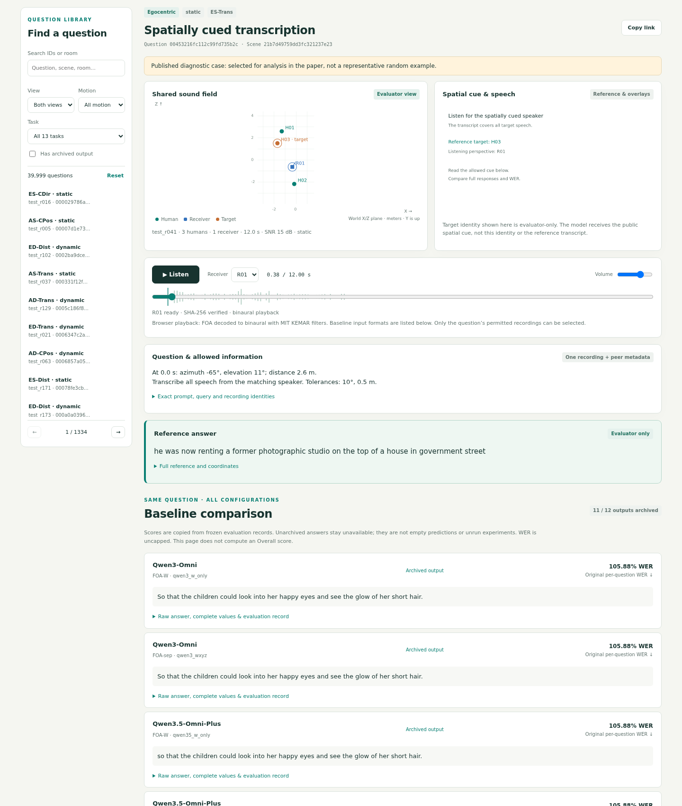

# MESH-Benchmark

**Multi-receiver Evaluation of Spatial Hearing across Egocentric and Allocentric Views**

Wen Wen\*, Bohan Li\*, KwanHo Tam, Yu Xi, Jing Peng, Shuai Wang, Kai Yu

\*Equal contribution

[Paper](https://arxiv.org/abs/2611.16787) · [Dataset](https://huggingface.co/datasets/Heiheihaha17/MESH-Benchmark) · [Interactive demo](https://wenanzhi.github.io/MESH-Benchmark/) · [Evaluation](docs/evaluation.md) · [Citation](#citation)

MESH evaluates whether a system can associate speech content with source position
across receiving perspectives and maintain that association as sources or receivers
move. Its 13 tasks require spatial estimates, trajectories and spatially grounded
transcriptions in simulated multi-speaker scenes, with synchronized recordings at
multiple receiving points.

## Explore the data and baselines

**[Open the data and baseline explorer →](https://wenanzhi.github.io/MESH-Benchmark/)**

Listen from the permitted receivers, inspect source positions and motion, and
compare all 12 published configurations on the same question. The site displays
frozen evaluation records and separates model inputs from evaluator-only answers.

[](https://wenanzhi.github.io/MESH-Benchmark/?q=00453216fc112c99fd735b2c)

*Actual explorer screenshot of a selected paper diagnostic case.*

All **39,999 questions** and **479,988 per-question score records** are available.
Actual archived outputs currently cover **47 records on 24 diagnostic questions**;
other rows explicitly show “Output not archived.” These selected cases do not
represent the full test distribution. MESH-agent's frozen scores cover the full
test even though its original outputs are not available in the explorer.
See [coverage and provenance](docs/demo.md).

## Benchmark at a glance

Egocentric tasks use one focal recording and permitted peer metadata. Allocentric
tasks use all synchronized receiver recordings and their permitted metadata.
Environmental sound acts as interference; the target is multi-speaker speech.

| Perspective | Static tasks | Dynamic tasks |
| --- | --- | --- |
| Egocentric | Direction; distance; content-conditioned direction and distance; spatially cued transcription | Direction tracking; distance tracking; spatially cued transcription under motion |
| Allocentric | Source positions; content-conditioned position; region-cued transcription | Content-conditioned position tracking; trajectory-cued transcription |

See [all 13 task definitions and permitted inputs](docs/tasks-and-inputs.md).

| Released data | Count |
| --- | ---: |
| Rooms / base scenes | 100 / 800 |
| Static / dynamic scene realizations | 800 / 1,600 |
| Receiver recordings | 4,761 |
| Static / dynamic questions | 19,117 / 20,882 |
| Distinct human speaker identities | 299 |

Audio is 16 kHz, four-channel first-order ambisonics (FOA), in ACN/SN3D
`[W, Y, Z, X]` order. Dynamic spatial answers use a 0.5-second grid.
Download the complete [HF release](https://huggingface.co/datasets/Heiheihaha17/MESH-Benchmark/tree/f7ca282fbb610206fe12336037c6cd0e587a7e55)
and preserve its directory structure; see [dataset documentation](docs/dataset.md).

## Published results

Overall scores below are copied from the frozen paper tables; higher is better.
Each perspective combines localization and semantic performance with equal
objective weights and equal question weights within each objective. Overall is
not an average of task columns or `1 − corpus WER`.

| Model | Input | Egocentric Overall ↑ | Allocentric Overall ↑ |
| --- | --- | ---: | ---: |
| Qwen3-Omni | FOA-W | 20.56 | 13.77 |
| Qwen3-Omni | FOA-sep | 21.41 | 14.22 |
| Qwen3.5-Omni-Plus | FOA-W | 24.75 | 19.45 |
| Qwen3.5-Omni-Plus | FOA-sep | 26.52 | 21.86 |
| BAT | Binaural | 0.07 | 0.04 |
| MiDasheng-Spatial | Binaural | 13.23 | 15.36 |
| Spatial-Omni-7B | FOA | 13.66 | 12.55 |
| Spatial-Omni-30B | FOA | 18.54 | 12.72 |
| JAEGER Neural | FOA | 2.80 | 6.58 |
| JAEGER Classical | FOA | 0.94 | 1.21 |
| Qwen3.8-Omni-Flash | FOA | 30.18 | 15.90 |
| MESH-agent | FOA | 34.97 | 31.01 |

FOA-W supplies the W channel; FOA-sep supplies four separately labeled mono
channels. Input conditions and model adapters remain explicit in the
[baseline registry](demo/data/baselines.json). See the [complete task results](docs/results.md)
for accuracy, uncapped WER, empty-region handling and interpretation.

## Evaluate and reproduce

Use Python 3.12. Install the evaluation package from the cloned repository:

```bash
python -m pip install -e .
```

Follow the [full evaluation procedure](docs/evaluation.md) for model inputs,
fixed response processing, official task scoring and Overall aggregation.
The scorer, processing policy and original tests are preserved from the initial
evaluation toolkit. This release performs no new inference or rescoring.

| Documentation | Contents |
| --- | --- |
| [Dataset](docs/dataset.md) | Complete release, counts, audio format and file layout |
| [Tasks and inputs](docs/tasks-and-inputs.md) | Task codes, permitted metadata and output conventions |
| [Evaluation](docs/evaluation.md) | Formal processing and scoring commands |
| [Reproducibility](docs/reproducibility.md) | Frozen revisions, configuration records and verification |
| [Explorer](docs/demo.md) | Output coverage, local serving and export regeneration |
| [Licenses](docs/licenses-and-attributions.md) | Code, dataset and third-party asset terms |
| [Contributing](CONTRIBUTING.md) | Bug reports and baseline result submissions |

The release binds dataset revision `f7ca282fbb610206fe12336037c6cd0e587a7e55`,
task protocol `dish_exhibition_v3.tasks.3`, scorer `dish_exhibition_v3.score.4`
and Overall `dish_case_equal_two_objectives_v1`.
Legacy `edge` / `cloud` JSON keys are retained for compatibility.
See [release metadata](release.json) and the [changelog](CHANGELOG.md).

## Citation

```bibtex
@misc{wen2026mesh,
  title={MESH: Multi-receiver Evaluation of Spatial Hearing across Egocentric and Allocentric Views},
  author={Wen Wen and Bohan Li and KwanHo Tam and Yu Xi and Jing Peng and Shuai Wang and Kai Yu},
  year={2026},
  eprint={2611.16787},
  archivePrefix={arXiv},
  url={https://arxiv.org/abs/2611.16787}
}
```

Machine-readable citation metadata is provided in [CITATION.cff](CITATION.cff).

## License and contact

Project-authored code and documentation use [Apache-2.0](LICENSE).
Dataset recordings, source speech, environmental audio, HRTFs, model weights
and reused player components retain their [respective licenses](docs/licenses-and-attributions.md).

For bugs or result submissions, use [GitHub issues](https://github.com/Wenanzhi/MESH-Benchmark/issues).
For research questions: [Wen Wen](mailto:wenyideng@sjtu.edu.cn) and
[Bohan Li](mailto:everlastingnight@sjtu.edu.cn).
